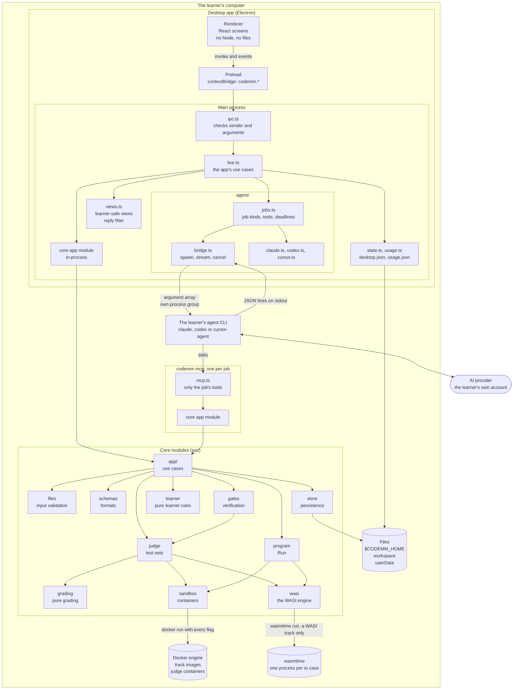
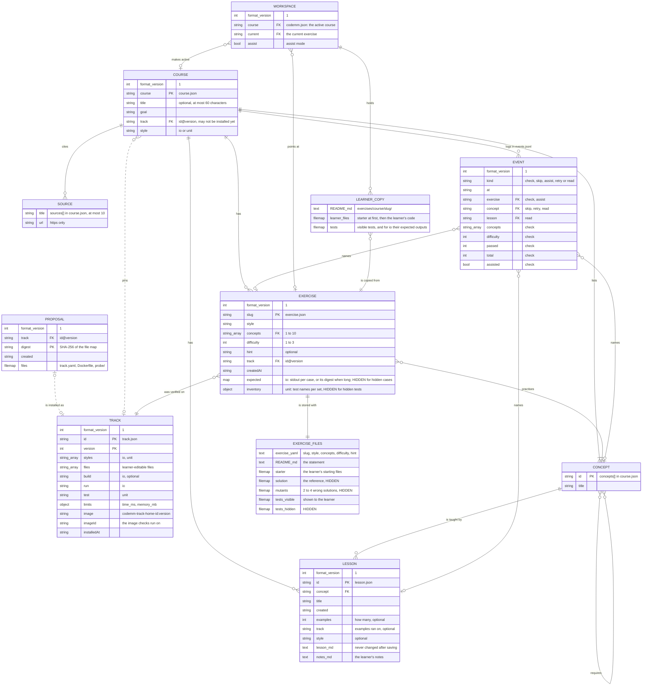
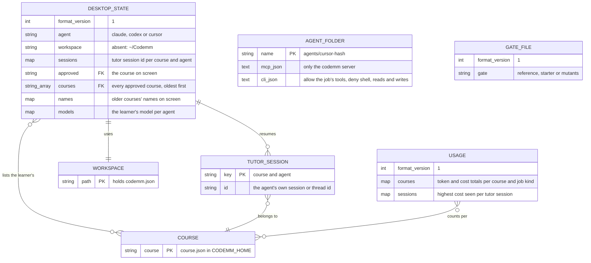
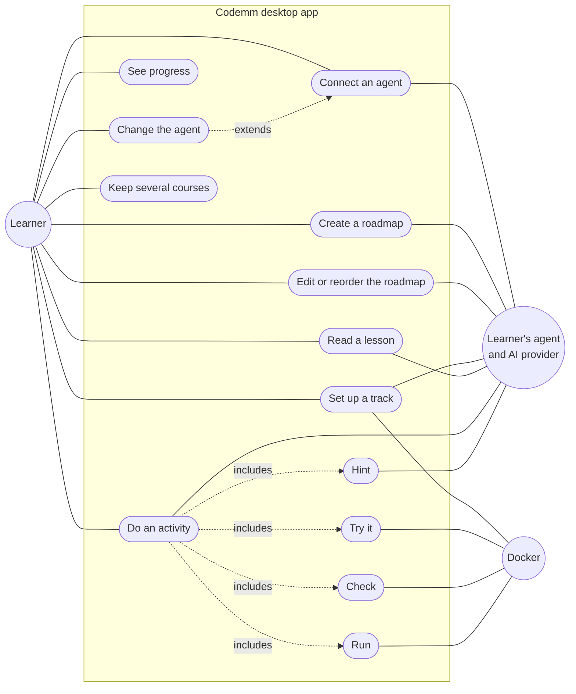
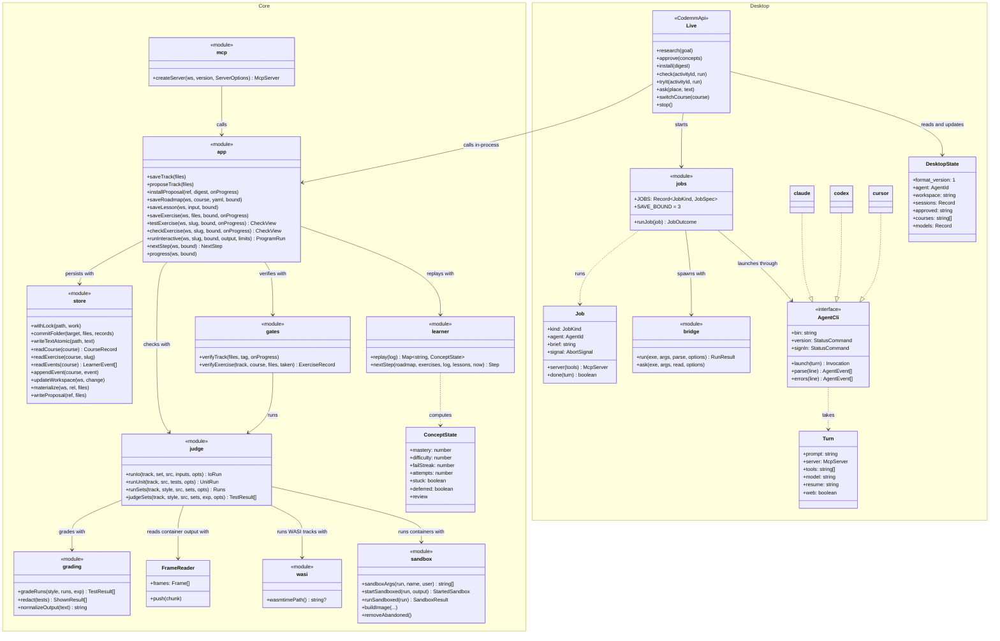
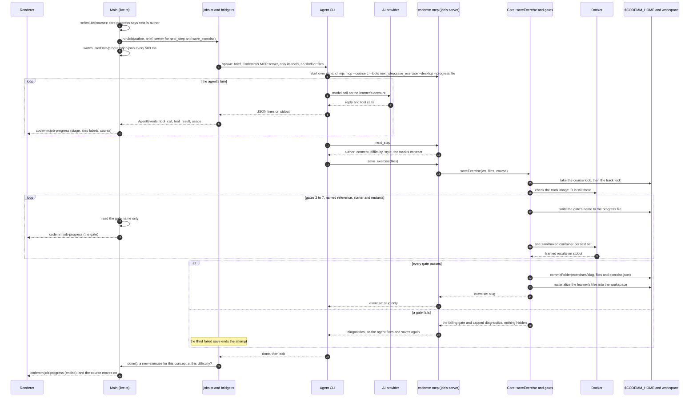
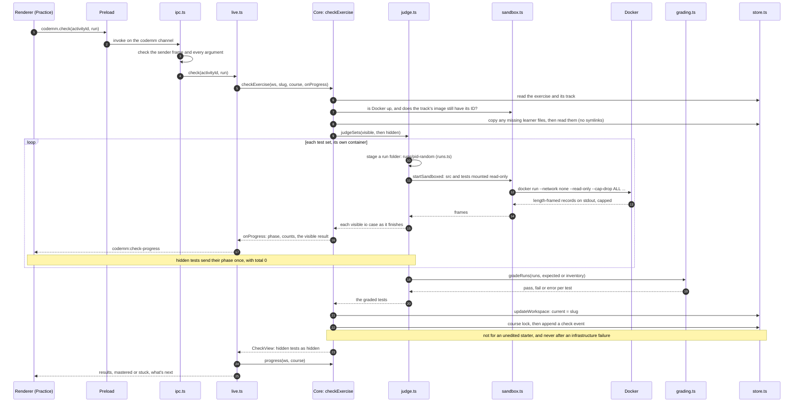
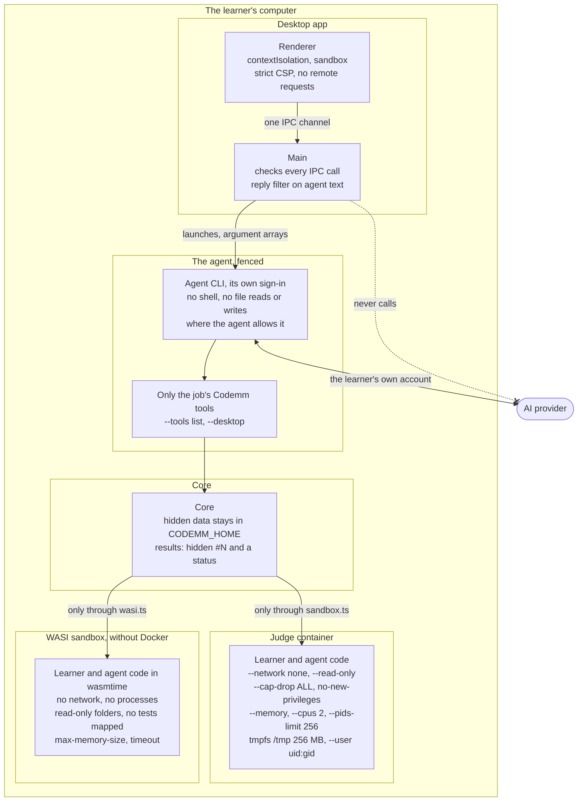

# How Codemm is built

This page explains Codemm's technical side with diagrams: the parts and how they connect, how the data is stored, what the learner can do, the main types, two flows end to end, and the security model. It is a guide, not a spec. The authoritative specs are [DESIGN.md](DESIGN.md) (the core) and [desktop/DESIGN.md](desktop/DESIGN.md) (the app), and [SECURITY.md](SECURITY.md) covers the trust boundaries. Where this page and a spec disagree, the spec wins, and this page should be fixed.

Every diagram is Mermaid, which GitHub draws in place. File links point at the code each fact comes from.

## Contents

1. [The parts](#1-the-parts)
2. [The data model](#2-the-data-model)
3. [What the learner does](#3-what-the-learner-does)
4. [Main types and modules](#4-main-types-and-modules)
5. [Two flows end to end](#5-two-flows-end-to-end)
6. [The security model](#6-the-security-model)
7. [Where to start reading](#7-where-to-start-reading)

## 1. The parts

Codemm has two halves:

- **The core** ([`src/`](../src)) is a Node library with a CLI and an MCP server. It verifies tracks, roadmaps, lessons and exercises, runs code in Docker (or, for a WASI track, in wasmtime), grades attempts and keeps the learner's progress. It ships no languages and never calls a model.
- **The desktop app** ([`desktop/`](../desktop)) is an Electron app. Its main process loads the core in-process and launches the learner's own agent CLI (Claude Code, Codex or Cursor) for each piece of work, with the core's MCP server as the agent's only tools (plus web search and fetch for research).

The AI provider is reached only by the agent CLI, on the learner's own account. Codemm never talks to it.



**How the pieces connect:**

- **Renderer to main.** The renderer has one door, `window.codemm`, which [`preload.ts`](../desktop/src/preload/preload.ts) builds on one IPC channel, `codemm`. Main pushes three one-way events back: `codemm:check-progress`, `codemm:job-progress` and `codemm:run-output` ([`main.ts`](../desktop/src/main/main.ts)). Every call is checked in [`ipc.ts`](../desktop/src/main/ipc.ts): the sender must be the app window, the method must be in `CodemmApi` ([`shared/api.ts`](../desktop/src/shared/api.ts)), and every argument must have the right shape.
- **Main to core, in-process.** [`wire.ts`](../desktop/src/main/wire.ts) loads the bundled core (`dist/app.cjs`) and hands it to [`live.ts`](../desktop/src/main/live.ts). Check, Try it, Run, notes, file saves, progress and track installs are direct calls into the bundled core: the `app` module ([`src/app.ts`](../src/app.ts)) plus a few helpers such as `cleanupLeftovers`, `runtimeState` and `networkIsolation` ([`desktop/scripts/core-entry.ts`](../desktop/scripts/core-entry.ts)).
- **Main to the agent.** Work that needs a model (research, roadmap changes, setup, lessons, exercises, tutor answers) is an agent job. [`jobs.ts`](../desktop/src/main/agent/jobs.ts) picks the job's tools and deadline, the agent's adapter turns that into launch arguments, and [`bridge.ts`](../desktop/src/main/agent/bridge.ts) spawns the CLI and reads its stream.
- **Agent to core.** The agent starts the core's MCP server itself, from the command Codemm gave it ([`server.ts`](../desktop/src/main/server.ts)): `<app> <core>/dist/cli.mjs mcp --workspace <ws> --course <course> --tools <list> --desktop [--progress <file>]`, run with `ELECTRON_RUN_AS_NODE=1`. So two processes write course data, main and the job's server, and the core's locks serialize them ([`store.ts`](../src/store.ts) `withLock`).
- **Core to Docker.** Only [`sandbox.ts`](../src/sandbox.ts) starts containers. For a Docker track, the judge, Run, the gates and lesson examples all go through it, and so does the self-test.
- **Core to wasmtime.** A track with a `wasi` block runs on the WASI engine instead, and only [`wasi.ts`](../src/wasi.ts) starts wasmtime: the bundled copy in `CODEMM_WASMTIME`, else `wasmtime` on `PATH` ([DESIGN §4.5](DESIGN.md#45-the-wasi-engine-no-docker)). When no container CLI (`docker` or `podman`) is installed, the MCP server's instructions say so, and the agent plans io practice and writes a WASI track.

The terminal flow is the same core without the app: `codemm init` sets up the agent's MCP config in a workspace ([`src/init.ts`](../src/init.ts)), and the agent calls the same tools.

## 2. The data model

Codemm has no SQL database. Its "database" is plain files: JSON records, an append-only JSON Lines log, and folders of files the agent wrote. They live in three places ([DESIGN §3](DESIGN.md#3-files-and-ids), [desktop DESIGN §2](desktop/DESIGN.md#2-architecture)):

```
$CODEMM_HOME (default ~/.codemm)                 the core's store (src/store.ts)
  tracks/<id>@<version>/                         track.yaml, Dockerfile, probe/, and track.json
  tracks/.<id>.lock                              held while a track is proposed, installed or rebuilt, and while a roadmap, lesson or exercise on it is saved
  proposals/<id>@<version>/<digest>/             proposal.json, and the proposed files under files/
  courses/<course>/
    course.json                                  the roadmap
    lessons/<id>/                                lesson.json, lesson.md, notes.md, examples/<n>/
    exercises/<slug>/                            every file the author saved, and exercise.json
    events.jsonl                                 the learner's events, append-only
    .lock                                        held while changing this course
  locks/ws-<hash>.lock                           held while changing a workspace: codemm.json, learner file saves, init
  runs/<pid>-<random>/                           files staged for one container (or one WASI check's test set), removed after it
  toolchains/<sha256>/                           a WASI track's unpacked toolchain, read-only, shared by every track that names that file
  toolchains/compiled/<sha256>-<version>.cwasm   that toolchain's module, compiled once by that wasmtime version, never mapped

<workspace> (the app's is ~/Codemm)              what the learner sees and edits
  codemm.json                                    the active course, the current exercise, assist mode
  exercises/<course>/<slug>/                     README.md, the learner's files, tests/ (visible only)

<userData> (Electron's folder for the app)       the desktop app's own state
  desktop.json                                   the agent, the workspace, the courses, tutor sessions, models
  usage.json                                     what the agent CLIs reported using, per course and job
  agents/cursor-<hash>/.cursor/                  Cursor's per-job config: mcp.json, cli.json
  progress/<job>.json                            the exercise gate an author job's save is running

<logs> (Electron's logs folder)                  codemm.log: lifecycle events only (desktop/src/main/log.ts)
```

**Rules every record follows** ([DESIGN §3](DESIGN.md#3-files-and-ids)):

- **Ids** match `^[a-z0-9][a-z0-9._-]{0,63}$` ([`files.ts`](../src/files.ts) `ID_PATTERN`), so no path is built from an unchecked id. A track is pinned as `id@version`.
- **Format versions.** Every record Codemm writes carries `format_version: 1`, and loaders reject any other ([`schemas.ts`](../src/schemas.ts)). A damaged record is named by its file, never echoed.
- **Atomic writes.** Records are written to a temp file and renamed (`writeTextAtomic`). Whole folders, such as an exercise or a lesson, are written to a fresh `.staging-*` folder and renamed into place (`commitFolder`). The event log is the one file that is appended to.
- **Locks** are files created whole by hard-linking a temp file. Each holds its owner's PID, and a lock whose owner is gone is stale. A second writer waits up to 10 minutes ([`store.ts`](../src/store.ts) `withLock`). The order is workspace, then course, then track.

### The core's records

The diagram below shows the records under `$CODEMM_HOME` and in the workspace, with their key fields from [`schemas.ts`](../src/schemas.ts). Fields marked **HIDDEN** never leave Codemm through its own outputs (tools, CLI, IPC or gate diagnostics). Concepts, sources and prerequisites are not files of their own: they are arrays inside `course.json`, drawn as entities to show how they relate.



**How the records relate:**

- **Track.** Installed under `tracks/<id>@<version>/` only after the track gates pass. `track.json` records the image ID the build reported, and every check verifies that the image still has it ([`app/shared.ts`](../src/app/shared.ts) `ensureImage`). The image tag carries 8 hex characters of the home's path hash, so two homes on one Docker don't collide ([`store.ts`](../src/store.ts) `trackImageTag`). A WASI track has no image: `track.json` records the SHA-256 it downloaded, and every check verifies that the toolchain and its compiled module are there.
- **Proposal.** In the desktop app, `save_track` only proposes ([`app/tracks.ts`](../src/app/tracks.ts) `proposeTrack`). The files are stored in an immutable folder named by their digest, and a new proposal for the same `id@version` replaces older ones (`writeProposal`). The learner's consent installs exactly that digest (`installProposal`).
- **Course.** `course.json` is the roadmap YAML, validated, plus `course` and `format_version` (`CourseRecord`). It pins one track by `id@version`, which may not be installed yet: then the next step is `setup`. Concepts and their `requires` form a graph with no cycles, checked with Kahn's algorithm (`parseRoadmapYaml`).
- **Lesson.** One concept per lesson. `lesson.md` never changes after saving, and `notes.md` beside it is the learner's ([`store.ts`](../src/store.ts) `writeLesson`, `writeNotes`). Runnable examples sit under `examples/<n>/`.
- **Exercise.** The folder holds every file the author saved, plus `exercise.json`, which Codemm writes from the gates' results: `expected` (io outputs from the reference) or `inventory` (unit test names per set) ([`gates.ts`](../src/gates.ts) `verifyExercise`).
- **Event log.** `events.jsonl` is the only learner state. Mastery, difficulty, stuck, reviews and the next step are recomputed by replaying it ([`learner.ts`](../src/learner.ts) `replay`, `nextStep`). A torn last line is backed up and dropped before the next append; any other bad line stops writes until it's fixed (`appendEvent`).
- **Workspace.** `codemm.json` says which course is active, which exercise is current and whether assist mode is on. `exercises/<course>/<slug>/` holds the learner's copy: the statement, the starter (then their code) and the visible tests. Codemm creates only missing files there and never overwrites the learner's (`materialize`). The app's editor saves a file only if its digest is still the one it loaded (`replaceLearnerFile`).

**Hidden data, in one place.** The solution, the mutants, the hidden tests, and the hidden entries of `expected` and `inventory` stay under `courses/<course>/exercises/<slug>/`. They are never copied to the workspace. Tool and CLI results show a hidden test only as `hidden #N` with a status ([`grading.ts`](../src/grading.ts) `redact`). An agent that has file access could still read `$CODEMM_HOME`; the desktop takes file access away from the agent where the agent allows it ([§6](#6-the-security-model)).

### The desktop app's records

The app keeps its own state in Electron's `userData` folder. `desktop.json` ([`state.ts`](../desktop/src/main/state.ts)) and `usage.json` ([`usage.ts`](../desktop/src/main/usage.ts)) carry `format_version` and are written through a temp file and a rename. Course data itself stays in the core's store.



- **Several courses.** A roadmap is a draft until the learner approves it. `approve` adds the course to `courses` and puts it on screen as `approved`; `switchCourse` changes `approved` ([`live.ts`](../desktop/src/main/live.ts)). A file from before several courses has `approved` alone, and `coursesOf` reads it as a list of one.
- **The agent.** `agent` is set by Connect, and `models` by the model picker ([`connect.ts`](../desktop/src/main/connect.ts)). Tutor sessions are kept per course and agent, so switching back to an agent resumes its conversation.
- **Job files.** A Cursor job runs in `agents/cursor-<hash>/`, named by its config, because Cursor reads its MCP servers and permissions from its working directory ([`jobs.ts`](../desktop/src/main/agent/jobs.ts) `jobFolder`). An author job's server writes the running gate's name to `progress/<job>.json`, and main reads only that name ([`gateFile.ts`](../desktop/src/main/agent/gateFile.ts)).

## 3. What the learner does

Mermaid has no use-case diagram, so this is a flowchart styled as one: the actors on the left, the use cases in the middle as rounded boxes, and the systems they rely on on the right.



| Use case | What happens | Where |
|---|---|---|
| Connect an agent | Codemm finds the CLI, installs it if asked, checks sign-in with the agent's own status command, and saves the choice in `desktop.json`. | `connect.ts`, `agentInstall.ts`, `agent/signedIn.ts` |
| Create a roadmap | A **research** job: the agent may search the web, calls `list_tracks`, then `save_roadmap` for a new course id. The roadmap is a draft until the learner approves it. | `live.ts` `research`, `approve` |
| Edit or reorder the roadmap | Before approving, the learner renames, adds, removes and moves topics, and each edit saves through the core's roadmap rules (`saveRoadmap`). "Ask Codemm for changes", and later "make this easier", are **roadmap** jobs. | `CourseEditor.tsx`, `live.ts` `saveDraft`, `reviseRoadmap`, `easier` |
| Set up a track | A **setup** job proposes a track (`save_track` only proposes). The learner consents in the app, and main installs exactly that proposal (`installProposal`): file checks, the build, then the probe gates in Docker. | `live.ts` `schedule`, `install` |
| Read a lesson | A **lesson** job writes it ahead of time (`save_lesson`). Reading is a direct call; "I've read it" records a `read` event. Notes save beside the lesson. | `live.ts` `lesson`, `markRead`, `saveNotes` |
| Do an activity | An **author** job writes the exercise ahead of time (`save_exercise`, through every gate). The learner edits the files in the app's editor. | `live.ts` `schedule`, `activity`, `saveFile` |
| Try it | Runs the visible tests only. Never recorded. | `core.testExercise` |
| Check | Runs every test and records a `check` event. Hidden tests show only an index and a status. | `core.checkExercise` |
| Hint | Asks the **tutor** ("Give me a hint."): an agent turn that resumes the course's session, with the tutor's tools. The reply passes the reply filter. | `Practice.tsx`, `live.ts` `ask` |
| Run | Runs the learner's io program once, interactively, in the sandbox. Never graded or recorded. | `core.runInteractive` |
| See progress | Mastery, difficulty, reviews and the next step, replayed from the event log. | `core.progress`, `courseView.ts` |
| Change the agent | Connect on another agent. A running job keeps its agent; the next job uses the new one. | `connect.ts` |
| Keep several courses | Approved courses are listed in `desktop.json`, and the sidebar switches between them. Each course's jobs queue on their own; track builds and author jobs take turns across courses. | `live.ts` `courses`, `switchCourse` |

The job kinds, their only tools and their deadlines are fixed in [`jobs.ts`](../desktop/src/main/agent/jobs.ts) `JOBS`:

| Job | Codemm tools | Deadline | Web |
|---|---|---|---|
| research | `list_tracks`, `save_roadmap` | 10 min | yes |
| roadmap | `get_roadmap`, `save_roadmap` | 10 min | no |
| setup | `list_tracks`, `save_track` | 10 min | no |
| lesson | `get_roadmap`, `save_lesson` | 5 min | no |
| author | `next_step`, `save_exercise` | 15 min | no |
| tutor | `progress`, `next_step`, `get_exercise`, `get_lesson`, `mark_lesson_read`, `get_roadmap`, `list_tracks` | 5 min | no |

## 4. Main types and modules

The class diagram keeps to the important types. Modules that export functions, not classes, are drawn as classes with the `module` stereotype.



- **The core's layers.** `mcp` and `cli` are thin entry points. Every use case is in `app/`, one file per area ([`tracks`](../src/app/tracks.ts), [`roadmaps`](../src/app/roadmaps.ts), [`lessons`](../src/app/lessons.ts), [`exercises`](../src/app/exercises.ts), [`progress`](../src/app/progress.ts)). `grading` and `learner` are pure functions. `store` owns every file write, and `sandbox` every container ([AGENTS.md](../AGENTS.md)).
- **The adapters.** Each agent is one `AgentCli` value ([`agents.ts`](../desktop/src/main/agent/agents.ts) `AGENT_CLIS`). `launch` turns a `Turn` into the CLI's arguments, plus config files for Cursor. `parse` turns one JSON line into common `AgentEvent`s: `session`, `text`, `tool_call`, `tool_result`, `server`, `done`, `progress` and `usage`. Nothing else in the app knows which agent runs.
- **The job runner.** A job that saves (research, setup, lesson, author) is done only when its `done` check against the core's records passes, never on the agent's word. A tutor turn, or a roadmap change, also passes when the agent's turn ends cleanly. An attempt ends at the deadline, at the third failed save (lesson and author jobs), or when a Codemm tool reports this computer's problem. `runJob` relaunches a failed attempt at most once, and never after a plan limit, a sign-out, going offline, a needed rebuild or this computer's problem, when the agent or Codemm's server failed to start, or while the agent or its container may still run.

## 5. Two flows end to end

### An agent job: writing an exercise

The app writes the next activity ahead of time with an author job. This is the longest flow, and it crosses every part.



- **Only the gate's name crosses.** The progress file holds `{ format_version, gate }` and nothing else ([`store.ts`](../src/store.ts) `writeJobProgress`). Main forwards to the renderer only a stage, fixed step labels, counts and times, and for research its web searches and pages read: never a Codemm tool's arguments or results ([desktop DESIGN §2.2](desktop/DESIGN.md#22-the-learner-safe-boundary)).
- **This computer's problems record nothing.** A Codemm tool result that starts with an infrastructure code (`codemm:<code>`) stops the job without a relaunch, and the learner sees what to fix ([`jobs.ts`](../desktop/src/main/agent/jobs.ts), [`errors.ts`](../src/errors.ts)).
- **A crash between commit and copy is safe.** The exercise is saved first. `get_exercise`, Try it and Check write any missing learner files again ([DESIGN §6](DESIGN.md#6-exercises-and-gates), commit point).

### A learner Check

A Check runs in main, in-process. No agent is involved.



- **A WASI track** follows the same steps, but [`wasi.ts`](../src/wasi.ts) runs one wasmtime process per io case instead of a container per set. Tests are never mapped: the host writes each input to stdin, and writes the frames itself into the same frame reader ([DESIGN §4.5](DESIGN.md#45-the-wasi-engine-no-docker)).
- **Visible and hidden tests never share a container**, so code run against visible tests can't read hidden ones ([`judge.ts`](../src/judge.ts) `runSets`).
- **Expected outputs never enter the container.** The host compares normalized output by SHA-256 as it streams ([`grading.ts`](../src/grading.ts)).
- **Learner-caused outcomes are graded.** A build failure, timeout, crash or output flood is `error`, and the check is recorded. A missing runtime, a changed image or a host-side kill throws before anything is recorded, and the app shows "not counted" ([`notCounted.ts`](../desktop/src/main/notCounted.ts)).
- **The event drives everything after.** The next `progress` call replays the log with the new event: mastery moves, difficulty may change, and the next step may be a new lesson or activity, which main schedules ([DESIGN §7](DESIGN.md#7-learner-model)).

## 6. The security model

Four boundaries keep the learner, their computer and the hidden data safe. [SECURITY.md](SECURITY.md) has the full list and the known limits.



- **Untrusted code runs only in containers, only through `sandbox.ts`,** or in wasmtime (below). Every judge container gets the same flags, built in one place ([`sandbox.ts`](../src/sandbox.ts) `sandboxArgs`). Among them: `--rm`, a unique `--name`, the `codemm=1` and `codemm.pid` labels, `--network none`, `--read-only`, a 256 MB `/tmp` tmpfs, `--memory` with an equal `--memory-swap`, `--cpus 2`, `--pids-limit 256`, `--security-opt no-new-privileges`, `--cap-drop ALL`, `--user` (the host's `uid:gid`, or `65534:65534` on Windows), `--entrypoint /bin/sh`, `--workdir /work/src`, `HOME=/tmp`, `--no-healthcheck` and `--log-opt max-size=1m` ([DESIGN §4.3](DESIGN.md#43-host-owned-sandbox-settings)). Files are mounted read-only from a run folder, and results come back on stdout, capped. `codemm doctor` proves the network is off with a positive control.
- **In wasmtime, only through `wasi.ts`,** for a track with a `wasi` block. The program sees only its toolchain's folders and the learner's files, both sealed read-only first, with no network, only the track's environment, a memory cap and a time limit. CPU isn't limited, but a WASI module runs on one thread ([SECURITY.md](SECURITY.md), [DESIGN §4.5](DESIGN.md#45-the-wasi-engine-no-docker)).
- **Building a track is a separate trust point.** A track's Dockerfile builds with network access (a WASI track instead downloads its toolchain over https), so in the app the agent can only propose it, and the learner consents to that exact digest ([DESIGN §4.4](DESIGN.md#44-installing-a-track-a-separate-trust-boundary)).
- **The agent is fenced to Codemm's tools.** Each job's server registers only that job's tools. Claude Code runs with `--tools ""` (research: `WebSearch,WebFetch`) and `--strict-mcp-config`; Codex with its shell features off and a read-only sandbox; Cursor with a job folder whose `cli.json` denies the shell, reads and writes ([desktop DESIGN §3.1](desktop/DESIGN.md#31-launch-isolate-stream-cancel-sign-in)). Only research may search the web. Those limits are as strong as each agent makes them, so they are defense in depth.
- **Hidden data never leaves through Codemm's outputs.** Hidden results carry an index and a status only (`redact`). Gate diagnostics never quote the reference or a mutant. IPC results are built in `views.ts`, and agent text passes a reply filter that holds back any reply quoting a line of hidden material ([`views.ts`](../desktop/src/main/views.ts) `filterReply`). Grading is still on the honor system: the files are on the learner's own computer.
- **No credentials, no model calls.** Codemm never calls a model API and never opens an agent's credentials. Sign-in is the agent's own status command, and only a yes, a no or "can't tell" is kept ([`signedIn.ts`](../desktop/src/main/agent/signedIn.ts)). Agent stderr is never shown or logged, because it can carry account details: it is drained, and read only to spot known failures, kept as fixed messages ([`bridge.ts`](../desktop/src/main/agent/bridge.ts)).
- **No host shell.** Every subprocess, Docker, wasmtime and the agents included, takes an argument array.

## 7. Where to start reading

| To understand | Read |
|---|---|
| The formats | [`src/schemas.ts`](../src/schemas.ts), then [`src/store.ts`](../src/store.ts) |
| A tool call | [`src/mcp.ts`](../src/mcp.ts), then the matching file in [`src/app/`](../src/app) |
| The gates | [`src/gates.ts`](../src/gates.ts), with [DESIGN §6](DESIGN.md#6-exercises-and-gates) |
| A check | [`src/app/exercises.ts`](../src/app/exercises.ts) `checkExercise`, [`src/judge.ts`](../src/judge.ts), [`src/sandbox.ts`](../src/sandbox.ts) |
| Mastery | [`src/learner.ts`](../src/learner.ts), with [DESIGN §7](DESIGN.md#7-learner-model) |
| An agent job | [`desktop/src/main/live.ts`](../desktop/src/main/live.ts) `start`, [`agent/jobs.ts`](../desktop/src/main/agent/jobs.ts), [`agent/bridge.ts`](../desktop/src/main/agent/bridge.ts) |
| One agent's flags | [`agent/claude.ts`](../desktop/src/main/agent/claude.ts), [`codex.ts`](../desktop/src/main/agent/codex.ts), [`cursor.ts`](../desktop/src/main/agent/cursor.ts) |
| The renderer's calls | [`desktop/src/shared/api.ts`](../desktop/src/shared/api.ts), [`preload.ts`](../desktop/src/preload/preload.ts), [`ipc.ts`](../desktop/src/main/ipc.ts) |
