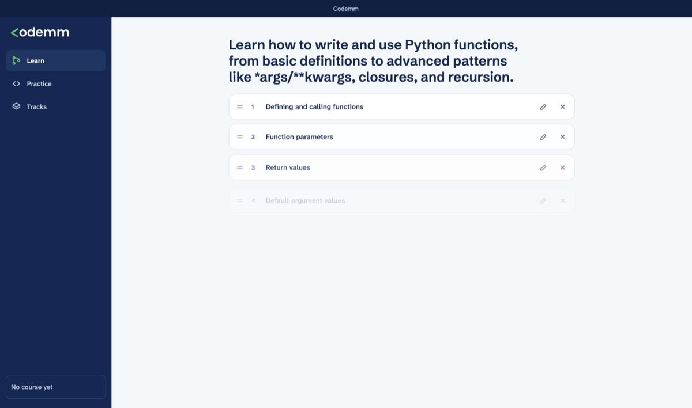
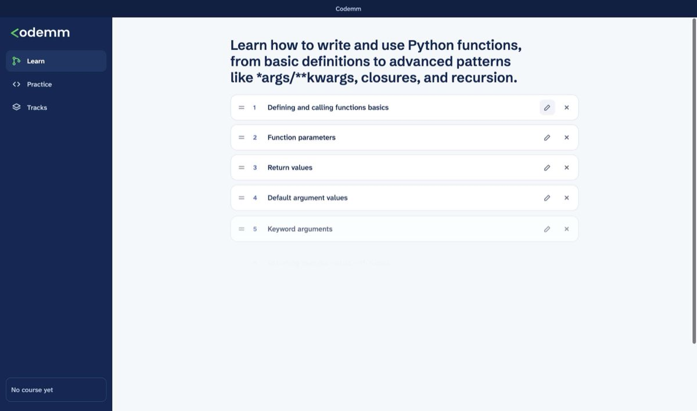
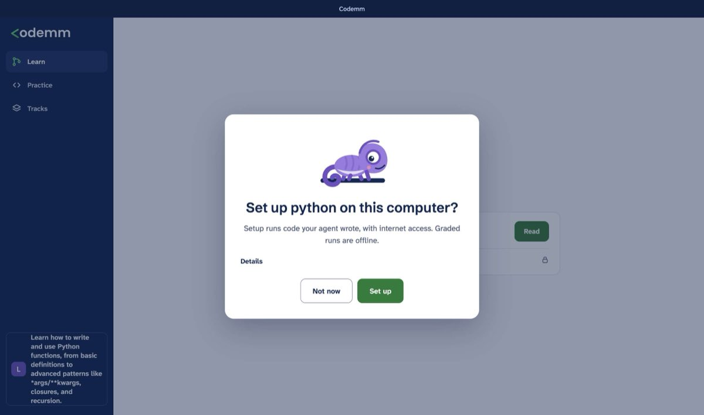

# Desktop journey on macOS (D17)

Status: **in progress.** The first real-agent runs found setup bugs, and Astra's 1.0 review asked for fixes before the full D17 run. Both runs were stopped at setup. This page records what has been verified so far. It will be updated with the full run.

## How it runs

- **Machine:** an Apple silicon Mac (arm64), macOS 15, with Docker Desktop 27.4 using Linux containers.
- **Agents:**
  - Claude Code 2.1.283, signed in with a personal plan;
  - Codex CLI 0.156.1, also on a personal plan.
  - `ANTHROPIC_API_KEY`, `ANTHROPIC_AUTH_TOKEN`, `CLAUDE_CODE_OAUTH_TOKEN`, `OPENAI_API_KEY` and `CODEX_API_KEY` are unset.
- **App:** built from main at 947e8dd plus #28 (the workspace folder setting) with `npm run dist -- --mac dmg --arm64`. The dmg is 131 MB.
  - It is mounted, and `Codemm.app` is copied to a temp `Applications` folder.
  - `codesign --verify --deep` passes (ad-hoc signature).
- **Isolation:** nothing touches the real `~/.codemm`, `~/Codemm` or the app's own data.
  - `CODEMM_HOME` is a temp folder.
  - The workspace is a temp folder, set in a temp `desktop.json`, which needs #28.
  - The app runs with `--user-data-dir=<temp>`.
- **Launch:** the app starts from a temp folder with `PATH=<temp>/bin:/usr/bin:/bin:/usr/sbin:/sbin`.
  - `<temp>/bin` holds only symlinks to the two agents' real launchers. Codex's is a `#!/usr/bin/env node` script.
  - Node and npm are not on that `PATH`.
- **Driver:** `desktop/e2e/journey.spec.ts`, which uses Playwright's Electron support. It drives the UI only.
  - As the learner, it writes a wrong answer, then the fixed answer, taken from the course's own reference solution in the temp `CODEMM_HOME`.
  - It times each step and screenshots it.

```bash
CODEMM_JOURNEY=<temp> CODEMM_APP=<temp>/Applications/Codemm.app/Contents/MacOS/Codemm JOURNEY_AGENT=claude JOURNEY_LABEL=claude-sonnet ANTHROPIC_MODEL=sonnet npx playwright test e2e/journey.spec.ts
```

Claude Code takes the model from `ANTHROPIC_MODEL`: the app passes the environment through unchanged (O1) and has no model picker (O6). Codex jobs run the recommended `gpt-5.6-luna`.

## Results so far

| Step | Claude Code, Sonnet | Codex, gpt-5.6-luna | Notes |
|---|---|---|---|
| Install the dmg, launch with no Node or npm on `PATH` | pass | pass | Same build for both. The ad-hoc signature verifies, and the app reads its data from the temp `--user-data-dir`. |
| Connect | pass, 5 s | not run yet | Detection: `docker-installed=ok docker-running=ok sandbox=ok`. |
| Research and the suggested path | pass, 17 s (11 topics) | not run yet | The research job takes 16 s. |
| Edit the course | pass | not run yet | Removed the last topic and renamed the first. |
| Consent and setup | **fail** | not run yet | See findings 1 and 2. |
| Lesson with a note | pass, earlier run | not run yet | The first lesson job takes 19 s, beside setup. The lesson renders as static Markdown. |
| Activity: Try it, wrong Check, hint, fixed Check | not reached | not run yet | |
| Skip | not reached | not run yet | |
| Progress | not reached | not run yet | |

The weak-model (Haiku) and strong-model (Opus) runs of the author and tutor steps, and the real failure states (Docker stopped mid-check, no agent on `PATH`), run after the fixes.





## Findings

1. **The setup job's done check fails when a proposal fails its gates quickly.**
   - The agent proposed the roadmap's track, `python@3`, and the learner approved it at once.
   - The gates rejected it 4 s later, and the rejected proposal is dropped.
   - Then the agent's turn ended. Its done check found no new proposal, so the job was relaunched with the old brief, which carries no gate problem.
2. **Nothing holds the setup agent to the roadmap's track.**
   - The relaunched agent proposed `python@1`, but the roadmap says `python@3`.
   - The done check rightly rejected it, so the job failed and background work stalled.
   - The topic page kept saying "Preparing setup for python" under a "Codemm couldn't finish that" banner.
   - The brief should name the exact track id and version, and a proposal for another track should be a failed save, not silence.
3. **The gate failure's reason is lost.** The proposal is dropped, the log records only `setup-failed problem=gates`, and the learner sees no reason. That's fine for the learner, but support has nothing to go on.
4. **Minor UI findings:**
   - The track shows its lowercase id ("Set up python on this computer?").
   - The sidebar's course card shows the research agent's long goal sentence instead of the learner's topic.
5. **The learner's own Claude Code hooks run inside agent jobs** (`hook_started` events). That follows O1, which keeps the environment unchanged, but it is worth knowing for support.
6. **A driver bug, not an app bug:** the first lesson can be ready before setup is proposed. The driver now waits for consent while "Preparing setup" shows.

Fixes from Astra's 1.0 review are in progress:
- #30: only safe errors leave main;
- #32: agent jobs stop safely and don't spend retries on infrastructure.
